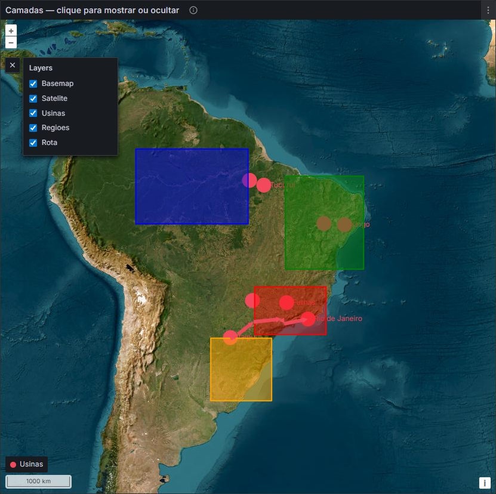

# Geomap Layers

Grafana Geomap panel with a legend to show or hide each layer, including the basemap.

Derived from [Grafana Geomap](https://github.com/grafana/grafana/tree/main/public/app/plugins/panel/geomap) (OpenLayers). Same map features as the native panel, plus runtime layer visibility and optional dashboard variable / URL sync.



## Requirements

- Grafana **12.0.0** or later
- Unsigned plugin allow-list until signed (`vericode-geomaplayers-panel`)
- License **AGPL-3.0** (same family as Grafana Geomap)

## Getting started

```bash
npm install
npm run build
npm run server
```

Open http://localhost:3000 (admin / admin). The provisioned demo dashboard is the home dashboard.

## Install into an existing Grafana

1. Copy the built `dist` folder to the plugins directory as `vericode-geomaplayers-panel`.
2. Allow the plugin id:

```ini
[plugins]
allow_loading_unsigned_plugins = vericode-geomaplayers-panel
```

3. Restart Grafana.

## Usage

1. Add a **Geomap Layers** panel and configure basemap / data layers (name each layer clearly).
2. Use the **Layers** control (top-left) to show or hide layers at runtime.
3. Optional — Map controls: enable **Sync layers to dashboard variable** and set the variable name (e.g. `mapLayers`).

Sync is one-way: combo / URL → panels. The legend does **not** write back to the variable. Presets can group layers with `|` in Custom variable values (e.g. `Usinas|Rota`).

## Documentation

- Portuguese guide: [docs/README.md](docs/README.md)

## License

GNU Affero General Public License v3.0 (AGPL-3.0). Based on the Grafana Geomap panel.
